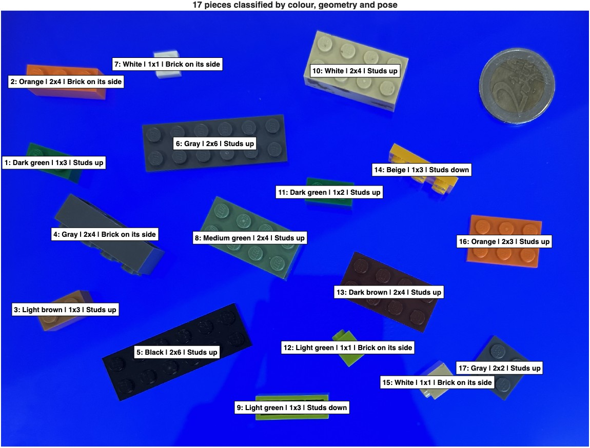
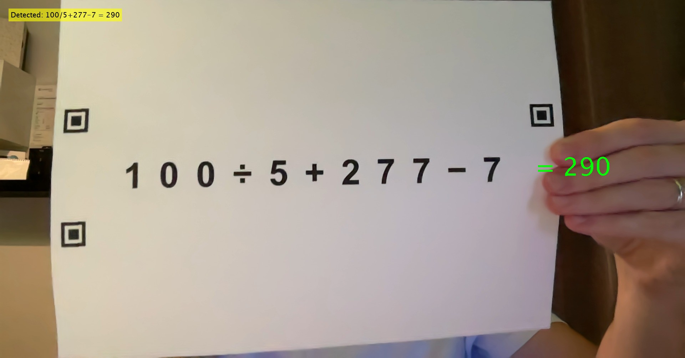

# Classical computer vision

Computer vision projects built with classical image processing in MATLAB:
segmentation, morphology, geometric measurement, Hough transform and template
matching, without neural networks or trained classifiers.

| Project | Techniques | Input |
|---|---|---|
| [LEGO piece detection and classification](lego-brick-detection/) | Colour segmentation, connected components, distance transform, scale from a reference object, circular Hough transform | Phone photos |
| [Real-time arithmetic expression reader](arithmetic-expression-reader/) | Otsu thresholding, fiducial markers, rotation correction, normalized cross-correlation | Live webcam video |

  
  

## How to run

Requires MATLAB with the Image Processing Toolbox (tested on R2025a). Each project
folder has a script that runs it on the included images, explained in its README.
