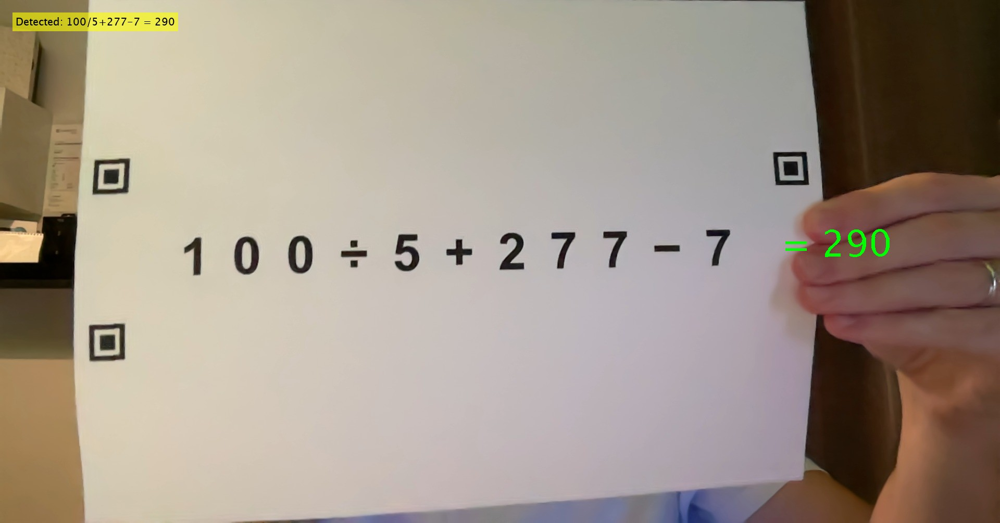
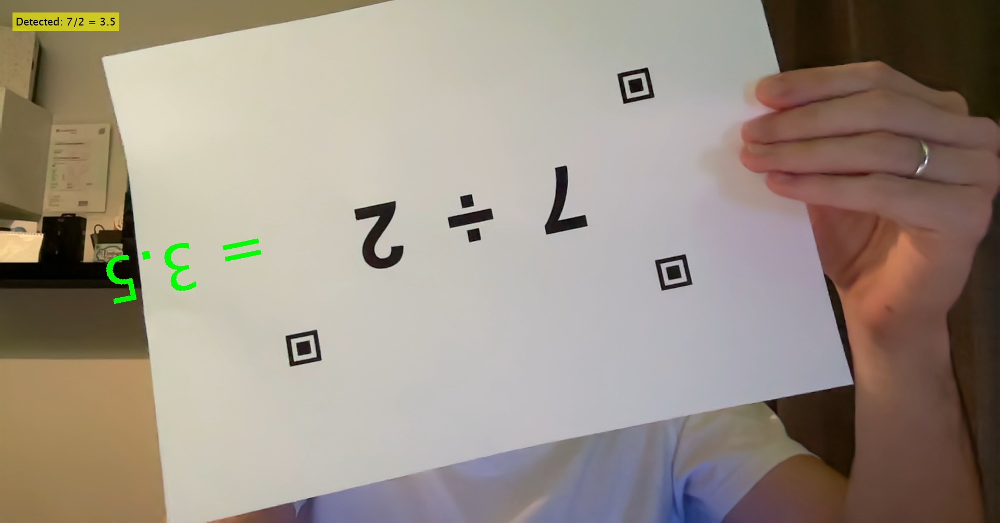
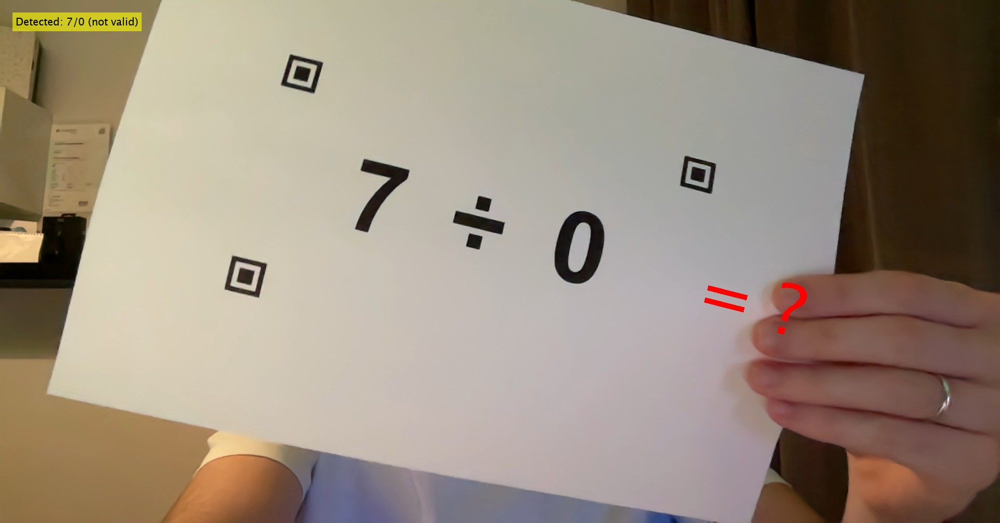
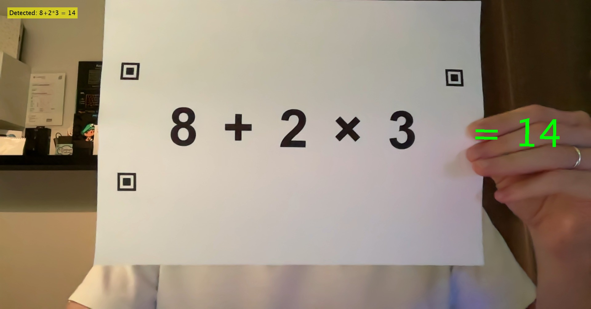
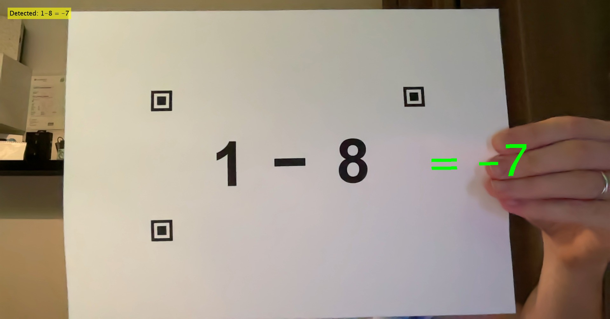

# Real-time arithmetic expression reader

Reads a printed arithmetic expression from a webcam in real time, evaluates it
and writes the result next to it on the video, following the sheet when it moves
or rotates. Built with classical image processing and template matching, without
OCR libraries or neural networks.

It supports the digits 0–9 and the operators + − × ÷, numbers of several digits,
operator precedence (`8 + 2 × 3 = 14`), negative and decimal results, and sheets
held at an angle or even upside down. Invalid readings and divisions by zero are
shown as `= ?` in red.

| | |
|---|---|
|  |  |
|  |  |

## How it works

The sheets have three square markers, like those of a QR code, in three of their
corners. They tell the program where the expression is and how the sheet is
rotated.

1. **Binarization** ([`binarize_frame.m`](src/binarize_frame.m)). Grey level, Otsu
   threshold, complement (characters white on black), border cleaning and an
   order filter to remove isolated noise pixels.
2. **Noise removal** ([`remove_small_objects.m`](src/remove_small_objects.m)).
   The object areas are sorted and the largest jump between consecutive areas
   separates noise from characters, so there is no fixed minimum area that would
   depend on the camera distance.
3. **Markers** ([`find_markers.m`](src/find_markers.m)). Once binarized, each
   marker is two objects (outer ring and inner square) with practically the same
   centroid, which no character satisfies. The six objects closest to a
   neighbour are the three rings and their squares. The markers are then told
   apart by the sum of their distances to the other two: the top-left one is in
   the corner (smallest sum) and the top-right one is the farthest, because the
   expression area is wider than it is tall.
4. **Rotation** ([`straighten_sheet.m`](src/straighten_sheet.m)). The angle of the
   line between the two top markers, computed with `atan2d`, gives the full
   rotation (−180° to 180°), so an upside-down sheet is also corrected and a 6 is
   never read as a 9.
5. **Expression area** ([`crop_expression_area.m`](src/crop_expression_area.m)).
   The area between the markers is cropped, with a margin measured on the marker
   itself so that it adapts to the camera distance.
6. **Characters** ([`group_characters.m`](src/group_characters.m)). The ÷ sign is
   three objects, so objects that overlap horizontally are merged into one
   character. Going from left to right, the characters come out in reading
   order, so the digits of a number stay together.
7. **Recognition** ([`recognize_characters.m`](src/recognize_characters.m)). Each
   character is compared with the templates using normalized cross-correlation
   (`normxcorr2`), after resizing the template to the size of the character. The
   templates come from webcam captures of three sheets (digits 0–4, 5–9 and
   operators) processed with exactly the same pipeline, so they have the same blur
   and stroke width as the live characters.
   - The minus sign fills almost all of its bounding box, so after normalization
     there is nothing left to compare and any template can win. It is recognized
     instead by the shape of its box: it is the only character much wider than
     tall.
8. **Evaluation** ([`evaluate_expression.m`](src/evaluate_expression.m)). The
   recognized text is checked with a regular expression (number, operator,
   number, ...) and evaluated respecting operator precedence.
9. **Display** ([`process_frame.m`](src/process_frame.m)). The result is written
   on a canvas aligned with the straightened sheet, rotated back to the frame and
   painted on the video, so it stays next to the expression however the sheet is
   held.

## Results

In the test frames ([`examples/`](examples/)), the expressions are read
correctly with the sheet straight, tilted or upside down. The main requirement is
that the three markers are fully visible: if one is hidden by a finger or out of
the frame, the program keeps showing "Looking for the sheet..." until it finds
them again.

## How to run

Requires MATLAB with the Image Processing Toolbox and the Computer Vision Toolbox
(tested on R2025a).

- **Without a webcam:** run [`run_on_images.m`](run_on_images.m). It processes the
  frames in [`examples/`](examples/), prints the expression and result of each one
  and shows them.
- **Live:** run [`run_webcam.m`](run_webcam.m) (needs the MATLAB Support Package
  for USB Webcams). Print a sheet from [`sheets/`](sheets/) at 100 % scale and hold
  it in front of the camera. Press any key on the figure to stop.

The [`sheets/`](sheets/) folder has the template sheets and test sheets with
expressions of increasing difficulty: one operator, two operators with
precedence, multi-digit numbers, and special cases (negative and decimal results,
division by zero).
