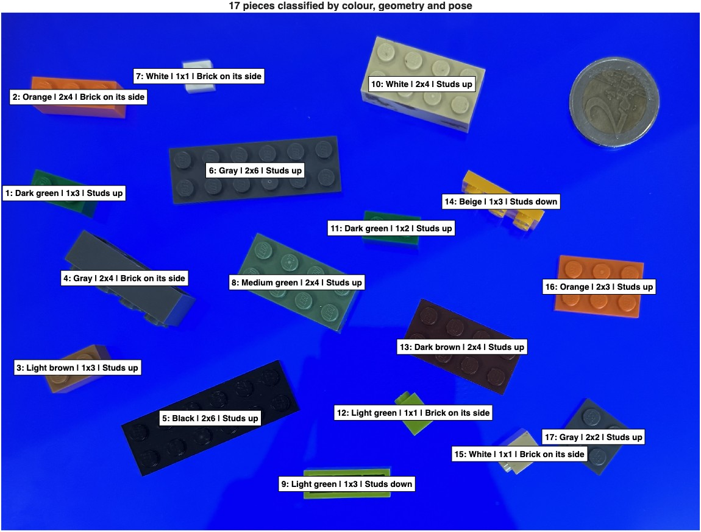
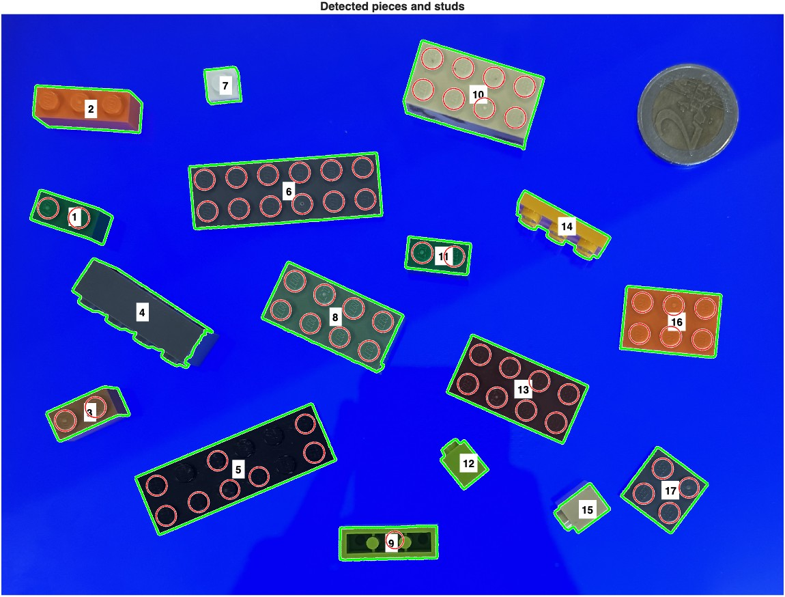

# LEGO piece detection and classification

Detects, counts and classifies LEGO pieces in a phone photo, using only classical
image processing (no neural networks or trained classifiers). For each piece it
finds:

- its **colour**, among 11 similar colours (three greens, two browns, beige,
  yellow, orange, grey, black and white);
- its **geometry**: 1×1, 1×2, 1×3, 2×2, 2×3, 2×4 or 2×6;
- its **pose**: lying flat (studs up or studs down) or on its side (brick or
  plate).

It works in any position and rotation, also with the pieces dropped on the table
(on their sides or upside down), and prints the counts by geometry, by colour
and by combination.

## How it works

The photos are taken roughly from above on a uniform blue background, with a
2-euro coin in the scene as size reference.

1. **Segmentation** ([`segment_pieces.m`](src/segment_pieces.m)). The blue plane
   is complemented and thresholded with Otsu. White pieces also contain a lot of
   blue and could disappear, so the red plane is thresholded too and both masks
   are combined with an OR. Then border cleaning, hole filling and a closing.
2. **Noise removal** ([`remove_noise_components.m`](src/remove_noise_components.m)).
   Instead of a fixed minimum area, which would depend on the camera distance,
   the component areas are sorted and the largest jump between consecutive areas
   separates noise from pieces.
3. **Scale** ([`find_coin_scale.m`](src/find_coin_scale.m)). The coin is the most
   circular object, and its radius is the maximum of the distance transform
   inside it. Its known diameter (25.75 mm) gives the pixels per millimetre.
4. **Colour** ([`color_features.m`](src/color_features.m)). Each piece is
   described by its RGB proportions R/(R+G+B), G/(R+G+B), B/(R+G+B), which do not
   change with the amount of light, plus its mean grey level, the only thing that
   separates black, grey and white. It gets the colour of the nearest reference
   (Euclidean distance).
5. **Size and geometry** ([`measure_piece.m`](src/measure_piece.m),
   [`classify_geometry.m`](src/classify_geometry.m)). Each piece is straightened
   with its orientation and measured in millimetres. From above only two of its
   three dimensions are visible, so the measurement is compared with the 21
   possible views (7 geometries × 3 poses: lying flat, brick on its side, plate
   on its side), and the nearest one gives the geometry and the pose at once.
6. **Studs up or down** ([`detect_studs.m`](src/detect_studs.m)). For the pieces
   lying flat, the studs are searched with the circular Hough transform on the
   Canny edges of the piece. The expected stud radius comes from the scale, so it
   adapts to the zoom of each photo. If more than half of the studs of that
   geometry are found, the piece is studs up.

### Colour calibration

The RGB proportions remove the effect of the amount of light, but not of its
type. The reference of each colour was therefore measured on photos taken under
three different lighting conditions and averaged. They are stored in
[`data/color_references.csv`](data/color_references.csv), together with the
photos they come from ([`data/color_calibration/`](data/color_calibration/)).
[`calibrate_colors.m`](calibrate_colors.m) adds the colours of a new photo to the
table, for example to support new lighting conditions. This is the only manual
step: it is done once, and the same references are used for every photo.

## Results and limitations

The number of pieces is correct in all the test photos, and most pieces lying
flat are classified correctly, usually within 2 mm of their expected size. The
main sources of error are:

- **Perspective.** Tall pieces are closer to the camera than the coin and, if
  the photo is not perfectly vertical, their side walls are visible and enter
  the mask. They are then measured larger than they are, so a brick on its side
  can be taken for a piece lying flat, or a 1×2 for a 1×3.
- **Dark pieces.** On black pieces the studs have very little contrast, and
  sometimes they are not found and the piece is marked as studs down.
- **Square pieces.** The orientation of a square region is not well defined, so
  a 2×2 may not be straightened perfectly.
- **Pieces standing on their end.** A 2×4 standing on its short side and a 1×2
  lying on its side look the same from above: with a single top view they cannot
  be told apart.

## How to run

Requires MATLAB with the Image Processing Toolbox (tested on R2025a).

1. Run [`run_demo.m`](run_demo.m). It processes `images/lego_09.jpeg`, prints the
   summary and shows the two result figures.
2. To try another photo, change `IMAGE_FILE` at the top of the script. The
   [`images/`](images/) folder has nine test photos.

New photos must be taken roughly from above on a uniform blue background, with
the pieces separated and a 2-euro coin fully visible and not touching any piece.
